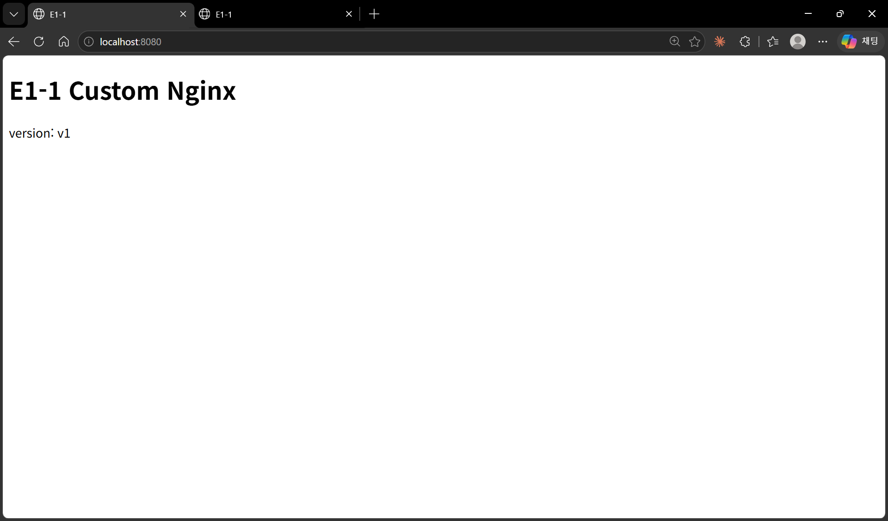
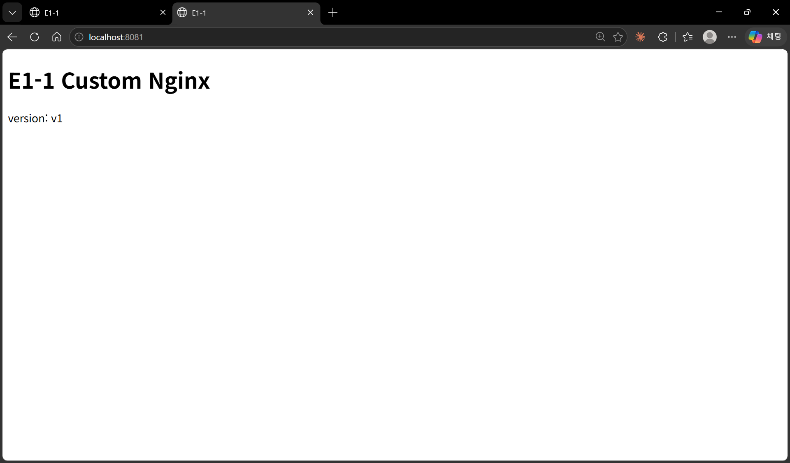
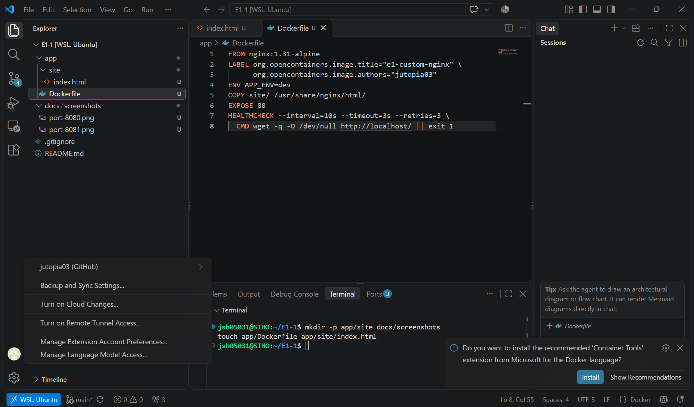
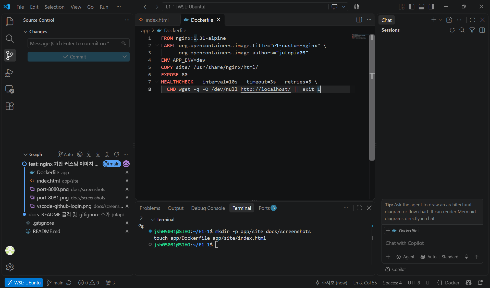
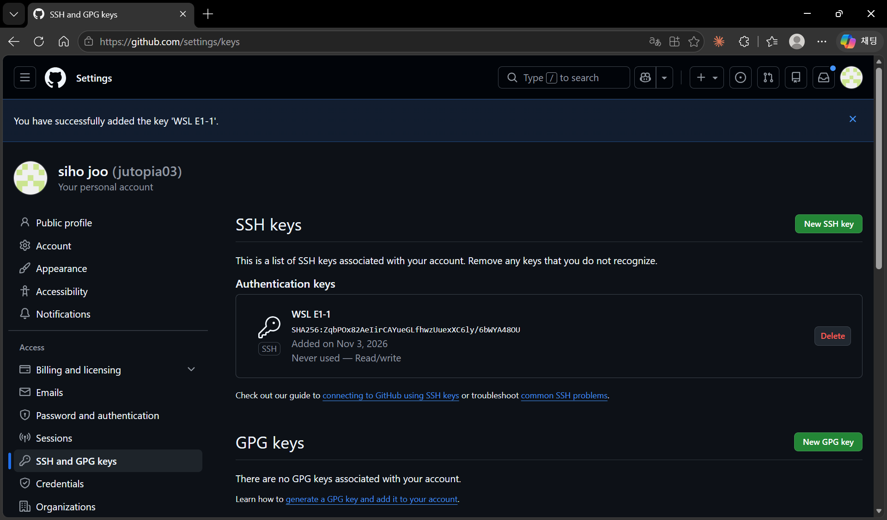

# E1-1. 개발 워크스테이션 구축

> 터미널·Docker·Git을 직접 세팅하고, 실행 결과(로그·접속·데이터 유지)로 동작을 검증한 기록

## 목차
1. [프로젝트 개요](#1-프로젝트-개요)
2. [실행 환경](#2-실행-환경)
3. [수행 체크리스트](#3-수행-체크리스트)
4. [저장소 구조](#4-저장소-구조)
5. [수행 로그](#5-수행-로그)
6. [보너스 과제](#6-보너스-과제)
7. [개념 정리](#7-개념-정리)
8. [트러블슈팅](#8-트러블슈팅)
9. [재현 방법](#9-재현-방법)
10. [보안 및 개인정보 처리](#10-보안-및-개인정보-처리)

---

## 1. 프로젝트 개요
- 목표: 이후 과제를 어느 PC에서든 같은 방식으로 실행·재현할 수 있도록 터미널·Docker·Git으로 개발 환경을 구성하고, 각 기능이 실제로 동작하는지 실행 결과로 확인한다.
- 수행 내용: WSL2 Ubuntu에 Docker Engine을 설치하고, nginx 기반 커스텀 이미지를 만들어 포트 매핑·바인드 마운트·볼륨을 실습했으며, 작업 결과를 Git으로 관리해 GitHub에 올렸다.
- 검증 방법: "설치했다"가 아니라 결과로 확인했다. 브라우저 접속(8080/8081), 호스트 파일 수정 후 즉시 반영(바인드 마운트), 컨테이너 삭제 후에도 남은 데이터(볼륨), GitHub push 기록을 근거로 남겼다.
- 핵심 흐름: 터미널/권한 정리 → Docker 설치·점검 → 컨테이너 운영 → Dockerfile 커스텀 이미지 → 포트 매핑 → 바인드 마운트/볼륨 → Git/GitHub 연동 → (보너스) Compose·환경 변수·SSH

## 2. 실행 환경
| 항목 | 값 |
|---|---|
| Host OS | Windows 11 Home |
| Linux 환경 | WSL2 / Ubuntu 24.04 LTS (noble), 커널 `6.18.33.2-microsoft-standard-WSL2` |
| Shell / Terminal | bash / Windows Terminal |
| Docker | Docker Engine - Community 29.9.2 (WSL Ubuntu에 apt로 직접 설치) |
| Docker Compose | v5.7.0 (docker-compose-plugin) |
| Git | 2.43.0 |
| Editor | VSCode + WSL 확장 (`WSL: Ubuntu` 원격 연결) |

> Docker Desktop 대신 WSL 안에 Docker Engine을 직접 설치했다. 권한 실습(chmod)과 Docker 실습을 같은 Linux 셸에서 수행하기 위해서다.

## 3. 수행 체크리스트
### 필수
- [x] 터미널 기본 조작 (이동/생성/복사/이동·이름변경/삭제/내용 확인/빈 파일) → [5-1](#5-1-터미널-기본-조작)
- [x] 권한 변경 실습 (파일 1, 디렉토리 1) → [5-2](#5-2-권한-실습)
- [x] Docker 설치 및 점검 (`--version`, `info`) → [5-3](#5-3-docker-설치-및-점검)
- [x] Docker 기본 운영 (pull, images, ps, logs, stats, stop) → [5-4](#5-4-docker-기본-운영-명령)
- [x] hello-world 실행 → [5-5](#5-5-컨테이너-실행-실습)
- [x] ubuntu 컨테이너 진입 및 attach/exec 차이 관찰 → [5-5](#5-5-컨테이너-실행-실습)
- [x] Dockerfile 커스텀 이미지 빌드·실행 (nginx 기반) → [5-6](#5-6-커스텀-이미지-방식-a-nginx-베이스)
- [x] 포트 매핑 접속 (8080, 8081 두 포트) → [5-7](#5-7-포트-매핑-및-접속-확인)
- [x] 바인드 마운트 변경 반영 → [5-8](#5-8-바인드-마운트-변경-반영)
- [x] Docker 볼륨 영속성 → [5-9](#5-9-docker-볼륨-영속성)
- [x] Git 설정 + VSCode GitHub 연동 → [5-10](#5-10-git-설정-및-github-연동)

### 보너스
- [x] Docker Compose 단일 서비스 → [6-1](#6-1-compose-단일-서비스)
- [x] Docker Compose 멀티 컨테이너 + 네트워크 통신 → [6-2](#6-2-compose-멀티-컨테이너--네트워크-통신)
- [x] Compose 운영 명령 (up/ps/logs/down) → [6-3](#6-3-compose-운영-명령-상태-확인-루틴)
- [x] 환경 변수로 포트/모드 변경 → [6-4](#6-4-환경-변수-활용)
- [x] GitHub SSH 키 설정 → [6-5](#6-5-github-ssh-키)

## 4. 저장소 구조
```text
E1-1/
├── README.md
├── .gitignore
├── app/
│   ├── Dockerfile            # nginx:1.31-alpine 기반 커스텀 이미지
│   └── site/
│       └── index.html        # 교체한 정적 콘텐츠
├── compose/
│   └── docker-compose.yml    # web + checker 멀티 컨테이너
└── docs/
    └── screenshots/          # 브라우저 / VSCode / GitHub 캡처
```

---

## 5. 수행 로그

> 모든 로그는 `script -a ~/e1-logs/<단계>.log`로 터미널 세션을 기록한 뒤 발췌했다.

### 5-1. 터미널 기본 조작
**확인 내용:** 현재 위치, 숨김 파일 포함 목록, 절대/상대 경로 이동, 생성, 복사, 이동/이름변경, 삭제, 내용 확인, 빈 파일 생성

```bash
$ pwd
/home/jsh05031

$ mkdir -p ~/practice/docs          # 중간 폴더까지 생성
$ cd ~/practice                     # 절대 경로 이동 (~ = /home/jsh05031)
$ pwd
/home/jsh05031/practice

$ touch empty.txt                   # 빈 파일
$ touch .hidden_note                # 숨김 파일 (.으로 시작)
$ ls                                # 숨김 파일은 보이지 않음
docs  empty.txt
$ ls -la                            # -a: 숨김 파일 포함
합계 12
drwxr-xr-x  3 jsh05031 jsh05031 4096 11월  3 14:20 .
drwxr-x--- 14 jsh05031 jsh05031 4096 11월  3 14:19 ..
-rw-r--r--  1 jsh05031 jsh05031    0 11월  3 14:20 .hidden_note
drwxr-xr-x  2 jsh05031 jsh05031 4096 11월  3 14:19 docs
-rw-r--r--  1 jsh05031 jsh05031    0 11월  3 14:20 empty.txt

$ echo "hello codyssey" > note.txt
$ cat note.txt                      # 내용 확인
hello codyssey

$ cp note.txt docs/                 # 복사 (상대 경로)
$ cp note.txt note_copy.txt
$ mv note_copy.txt docs/renamed.txt # 이동 + 이름변경
$ mv empty.txt blank.txt            # 이름변경
$ ls -la . docs
.:
-rw-r--r--  1 jsh05031 jsh05031    0 11월  3 14:20 .hidden_note
-rw-r--r--  1 jsh05031 jsh05031    0 11월  3 14:20 blank.txt
drwxr-xr-x  2 jsh05031 jsh05031 4096 11월  3 14:21 docs
-rw-r--r--  1 jsh05031 jsh05031   15 11월  3 14:20 note.txt

docs:
-rw-r--r-- 1 jsh05031 jsh05031   15 11월  3 14:20 note.txt
-rw-r--r-- 1 jsh05031 jsh05031   15 11월  3 14:21 renamed.txt

$ cd docs && pwd                    # 상대 경로 진입
/home/jsh05031/practice/docs
$ cd .. && pwd                      # .. = 상위 디렉토리
/home/jsh05031/practice

$ rm docs/renamed.txt               # 파일 삭제
$ mkdir trash && rmdir trash        # 빈 디렉토리 생성 후 삭제
$ ls -la docs
-rw-r--r-- 1 jsh05031 jsh05031   15 11월  3 14:20 note.txt
```

### 5-2. 권한 실습
**확인 내용:** 파일 1개(`note.txt`)·디렉토리 1개(`docs`)의 권한 변경 전/후. `stat -c '%A %a %n'`으로 기호 표기와 숫자 표기를 함께 출력했다.

```bash
# 파일
$ stat -c '%A %a %n' note.txt
-rw-r--r-- 644 note.txt
$ chmod 755 note.txt
$ stat -c '%A %a %n' note.txt
-rwxr-xr-x 755 note.txt
$ chmod 600 note.txt
$ stat -c '%A %a %n' note.txt
-rw------- 600 note.txt

# 디렉토리
$ stat -c '%A %a %n' docs
drwxr-xr-x 755 docs
$ chmod 700 docs
$ stat -c '%A %a %n' docs
drwx------ 700 docs

# 디렉토리에서 x(실행) 권한을 제거하면?
$ chmod 644 docs
$ ls docs
ls: 'docs/note.txt'에 접근할 수 없음: 허가 거부
note.txt
$ cd docs
bash: cd: docs: 허가 거부

$ chmod 755 docs                    # 복구
$ stat -c '%A %a %n' docs
drwxr-xr-x 755 docs
```

| 대상 | 변경 전 | 변경 후 | 의미 |
|---|---|---|---|
| 파일 `note.txt` | `644` `-rw-r--r--` | `755` `-rwxr-xr-x` | 소유자 rwx, 그룹·기타 r-x (실행 가능) |
| 파일 `note.txt` | `755` | `600` `-rw-------` | 소유자만 읽기/쓰기, 나머지 접근 불가 |
| 디렉토리 `docs` | `755` `drwxr-xr-x` | `700` `drwx------` | 소유자만 목록 조회·진입 가능 |
| 디렉토리 `docs` | `700` | `644` `drw-r--r--` | x 없음 → 이름 목록(r)은 보이지만 진입·파일 접근 불가 |

**관찰:** 디렉토리에서 `r`은 **안의 이름 목록을 읽는 권한**, `x`는 **안으로 들어가 파일 정보에 접근하는 권한**이다. `644`에서 `ls`가 이름(`note.txt`)은 출력하면서도 접근 오류를 낸 것이 그 근거다.

> 추가 사례: 개인키 `~/.ssh/id_ed25519`는 `600`, 공개키 `.pub`는 `644`, `~/.ssh`는 `700`으로 생성되었다([6-5](#6-5-github-ssh-키)). 권한 설계가 보안과 직결되는 예다.

### 5-3. Docker 설치 및 점검
WSL Ubuntu에 Docker 공식 apt 저장소를 등록해 설치했다.

```bash
$ sudo install -m 0755 -d /etc/apt/keyrings
$ sudo curl -fsSL https://download.docker.com/linux/ubuntu/gpg -o /etc/apt/keyrings/docker.asc
$ sudo chmod a+r /etc/apt/keyrings/docker.asc
$ echo "deb [arch=$(dpkg --print-architecture) signed-by=/etc/apt/keyrings/docker.asc] https://download.docker.com/linux/ubuntu $(. /etc/os-release && echo "${UBUNTU_CODENAME:-$VERSION_CODENAME}") stable" | sudo tee /etc/apt/sources.list.d/docker.list
$ sudo apt-get update
$ sudo apt-get install -y docker-ce docker-ce-cli containerd.io docker-buildx-plugin docker-compose-plugin
$ sudo usermod -aG docker $USER     # sudo 없이 docker 사용 (재로그인 후 적용)
```

| 단계 | 목적 |
|---|---|
| keyrings + gpg | 패키지가 Docker 공식 배포본인지 서명으로 검증 |
| `docker.list` | apt가 Docker 공식 저장소에서 패키지를 찾도록 등록 |
| `usermod -aG docker` | docker 그룹 사용자는 데몬 소켓에 접근 가능 (사실상 root 권한이므로 주의) |

**버전 및 데몬 동작 확인**
```bash
$ docker --version
Docker version 29.9.2, build a82e528

$ docker compose version
Docker Compose version v5.7.0

$ docker info | head -30
Client: Docker Engine - Community
 Version:    29.9.2
 Context:    default
 ...
Server:
 Containers: 0
  Running: 0
  Paused: 0
  Stopped: 0
 Images: 0
 Server Version: 29.9.2
 Storage Driver: overlayfs
 Logging Driver: json-file
 Cgroup Driver: systemd
 Cgroup Version: 2
```
→ `Server:` 섹션이 출력되므로 **데몬이 정상 동작 중**이다 (데몬이 꺼져 있으면 `Cannot connect to the Docker daemon` 오류).

### 5-4. Docker 기본 운영 명령
```bash
# 이미지 다운로드 / 목록
$ docker pull nginx:alpine
Status: Downloaded newer image for nginx:alpine
$ docker pull ubuntu:24.04
Status: Downloaded newer image for ubuntu:24.04
$ docker images
IMAGE                ID             DISK USAGE   CONTENT SIZE   EXTRA
hello-world:latest   c567b231f656       25.9kB         9.49kB    U
nginx:alpine         785835ea65db       94.5MB         27.2MB
ubuntu:24.04         fe81560990fa        119MB         31.7MB

# 컨테이너 실행 / 목록
$ docker run -d --name ops-nginx nginx:alpine
2369bbbb6d119096840236d1ecb8b54cf2a903537d661321b4ddc97702492e85
$ docker ps
CONTAINER ID   IMAGE          COMMAND                   CREATED         STATUS         PORTS     NAMES
2369bbbb6d11   nginx:alpine   "/docker-entrypoint.…"   3 seconds ago   Up 2 seconds   80/tcp    ops-nginx

# 로그
$ docker logs ops-nginx
/docker-entrypoint.sh: Configuration complete; ready for start up
2026/11/03 05:30:04 [notice] 1#1: nginx/1.31.8
2026/11/03 05:30:04 [notice] 1#1: start worker processes
2026/11/03 05:30:04 [notice] 1#1: start worker process 30
...
2026/11/03 05:30:04 [notice] 1#1: start worker process 51

# 리소스
$ docker stats --no-stream
CONTAINER ID   NAME          CPU %     MEM USAGE / LIMIT     MEM %     NET I/O       BLOCK I/O   PIDS
dcd70fc4a10d   ubuntu-test   0.00%     1.578MiB / 15.37GiB   0.01%     780B / 126B   0B / 0B     1
2369bbbb6d11   ops-nginx     0.00%     18.85MiB / 15.37GiB   0.12%     932B / 126B   0B / 0B     23

# 중지 / 전체 목록
$ docker stop ops-nginx
$ docker ps
CONTAINER ID   IMAGE     COMMAND   CREATED   STATUS    PORTS     NAMES
$ docker ps -a
CONTAINER ID   IMAGE          COMMAND                   CREATED          STATUS                      NAMES
2369bbbb6d11   nginx:alpine   "/docker-entrypoint.…"   37 seconds ago   Exited (0) 7 seconds ago    ops-nginx
6fecf96984b2   hello-world    "/hello"                  17 minutes ago   Exited (0) 17 minutes ago   interesting_antonelli
```

**관찰:**
- `docker ps`는 실행 중인 컨테이너만, `docker ps -a`는 종료된 컨테이너까지 보여준다. 중지(stop)는 삭제가 아니다.
- `stats`의 PIDS가 ops-nginx는 23 = 마스터 1 + 워커 22개로, `docker logs`의 `start worker process 30~51`(22개)과 일치한다. ubuntu-test는 bash 하나라 1이다.

### 5-5. 컨테이너 실행 실습
#### hello-world
```bash
$ docker run hello-world
Unable to find image 'hello-world:latest' locally
latest: Pulling from library/hello-world
Status: Downloaded newer image for hello-world:latest

Hello from Docker!
This message shows that your installation appears to be working correctly.
...
 1. The Docker client contacted the Docker daemon.
 2. The Docker daemon pulled the "hello-world" image from the Docker Hub.
 3. The Docker daemon created a new container from that image which runs the
    executable that produces the output you are currently reading.
 4. The Docker daemon streamed that output to the Docker client, which sent it
    to your terminal.
```

#### ubuntu 컨테이너 진입
```bash
$ docker run -it --name ubuntu-test ubuntu:24.04 bash
root@dcd70fc4a10d:/# ls
bin   dev  home  lib64  mnt  proc  run   srv  tmp  var
boot  etc  lib   media  opt  root  sbin  sys  usr
root@dcd70fc4a10d:/# echo "hello from container"
hello from container
root@dcd70fc4a10d:/# cat /etc/os-release | head -2
PRETTY_NAME="Ubuntu 24.04.5 LTS"
NAME="Ubuntu"
root@dcd70fc4a10d:/# hostname
dcd70fc4a10d                        # 호스트명 = 컨테이너 ID
root@dcd70fc4a10d:/# exit
$ docker ps -a
dcd70fc4a10d   ubuntu:24.04   "bash"   43 seconds ago   Exited (0) 5 seconds ago   ubuntu-test
```

#### attach vs exec 관찰
```bash
# (1) attach 후 exit
$ docker start ubuntu-test
$ docker attach ubuntu-test
root@dcd70fc4a10d:/# echo "attached"
attached
root@dcd70fc4a10d:/# exit
$ docker ps -a
dcd70fc4a10d   ubuntu:24.04   "bash"   About a minute ago   Exited (0) 3 seconds ago   ubuntu-test

# (2) exec 후 exit
$ docker start ubuntu-test
$ docker exec -it ubuntu-test bash
root@dcd70fc4a10d:/# echo "exec"
exec
root@dcd70fc4a10d:/# exit
$ docker ps
dcd70fc4a10d   ubuntu:24.04   "bash"   About a minute ago   Up 20 seconds   ubuntu-test

# (3) attach 후 Ctrl+P, Ctrl+Q (detach)
$ docker attach ubuntu-test
root@dcd70fc4a10d:/# read escape sequence
$ docker ps
dcd70fc4a10d   ubuntu:24.04   "bash"   6 minutes ago   Up About a minute   ubuntu-test
```

| 구분 | 동작 | 빠져나왔을 때 컨테이너 상태 |
|---|---|---|
| `docker attach` + `exit` | 메인 프로세스(PID 1 bash)에 직접 연결 → 그 bash를 종료 | **Exited** |
| `docker attach` + `Ctrl+P, Ctrl+Q` | 메인 프로세스에서 연결만 분리 | **Up** |
| `docker exec -it ... bash` + `exit` | 별도의 bash를 새로 띄웠다가 그것만 종료 | **Up** |

**정리:** 컨테이너는 **메인 프로세스(PID 1)가 끝나면 함께 종료**된다. attach는 메인 프로세스에 붙는 것이고, exec는 추가 프로세스를 띄우는 것이다. 운영 중인 컨테이너를 점검할 때는 exec가 안전하다.

### 5-6. 커스텀 이미지 (방식 A: nginx 베이스)
- **선택한 베이스:** `nginx:1.31-alpine` (공식 nginx 이미지의 Alpine 변형)
  - 검증된 웹 서버를 그대로 쓰고 콘텐츠·설정만 바꾸는 방식이 가장 단순하고, 포트 매핑·바인드 마운트 실습과 자연스럽게 연결된다.
  - Alpine 기반이라 작다 (CONTENT SIZE 26.3MB).

[`app/Dockerfile`](app/Dockerfile)
```dockerfile
FROM nginx:1.31-alpine
LABEL org.opencontainers.image.title="e1-custom-nginx" \
      org.opencontainers.image.authors="jutopia03"
ENV APP_ENV=dev
COPY site/ /usr/share/nginx/html/
EXPOSE 80
HEALTHCHECK --interval=10s --timeout=3s --retries=3 \
  CMD wget -q -O /dev/null http://localhost/ || exit 1
```

| 커스텀 포인트 | 목적 |
|---|---|
| `FROM nginx:1.31-alpine` | 태그에 버전을 고정해 언제 빌드해도 같은 베이스를 쓰도록 함 (재현성) |
| `LABEL` | 이미지에 제목·작성자 메타데이터 부여 (`docker inspect`로 확인) |
| `ENV APP_ENV=dev` | 실행 모드 기본값을 환경 변수로 분리 (실행 시 덮어쓰기 가능 → [6-4](#6-4-환경-변수-활용)) |
| `COPY site/ ...` | 기본 nginx 환영 페이지를 내 정적 콘텐츠로 교체 |
| `EXPOSE 80` | 컨테이너가 사용하는 포트를 문서화 (실제 연결은 `-p`) |
| `HEALTHCHECK` | 10초마다 자기 자신에 HTTP 요청 → `healthy/unhealthy` 상태 표시 |

**빌드 및 확인**
```bash
$ cd ~/E1-1/app
$ docker build -t e1-web:1.0 .
[+] Building 7.1s (7/7) FINISHED
 => [internal] load build definition from Dockerfile
 => [1/2] FROM docker.io/library/nginx:1.31-alpine@sha256...
 => [2/2] COPY site/ /usr/share/nginx/html/
 => exporting to image
 => => naming to docker.io/library/e1-web:1.0

$ docker images e1-web
IMAGE        ID             DISK USAGE   CONTENT SIZE
e1-web:1.0   44b90b56a42d       93.6MB         26.3MB

$ docker inspect --format '{{json .Config.Labels}}' e1-web:1.0
$ docker inspect --format '{{json .Config.Env}}' e1-web:1.0
```

**관찰:** 빌드 단계가 `[1/2] FROM`, `[2/2] COPY` 두 개뿐이다. `LABEL`·`ENV`·`EXPOSE`·`HEALTHCHECK`는 파일시스템 레이어를 만들지 않고 **이미지 설정(메타데이터)** 에만 기록되기 때문이다.

### 5-7. 포트 매핑 및 접속 확인
같은 이미지를 호스트 포트만 다르게 두 개 실행했다.

```bash
$ docker run -d --name e1-web-8080 -p 8080:80 e1-web:1.0
$ docker run -d --name e1-web-8081 -p 8081:80 e1-web:1.0
$ docker ps
CONTAINER ID   IMAGE        STATUS                            PORTS                                     NAMES
609d90e695b0   e1-web:1.0   Up 4 seconds (health: starting)   0.0.0.0:8081->80/tcp, [::]:8081->80/tcp   e1-web-8081
baf1c12c3e4a   e1-web:1.0   Up 30 seconds (healthy)           0.0.0.0:8080->80/tcp, [::]:8080->80/tcp   e1-web-8080

$ curl -i http://localhost:8080
$ curl http://localhost:8081
$ docker inspect --format '{{.State.Health.Status}}' e1-web-8080
healthy
```
→ HEALTHCHECK는 실행 직후 `health: starting`, 첫 검사 통과 후 `healthy`로 바뀐다.

**브라우저 접속 (Windows 브라우저 → WSL 컨테이너)**

| `localhost:8080` | `localhost:8081` |
|---|---|
|  |  |

### 5-8. 바인드 마운트 변경 반영
호스트의 `app/site` 폴더를 컨테이너의 html 폴더에 직접 연결하고, 호스트에서 파일을 수정했다.

```bash
$ cd ~/E1-1/app
$ docker run -d --name e1-bind -p 8082:80 \
    -v "$(pwd)/site:/usr/share/nginx/html:ro" e1-web:1.0

# 변경 전
$ grep version site/index.html
  <p>version: v1</p>
$ curl -s http://localhost:8082 | grep version
  <p>version: v1</p>

# 호스트에서 파일 수정
$ sed -i 's/v1/v2/' site/index.html
$ grep version site/index.html
  <p>version: v2</p>

# 변경 후
$ curl -s http://localhost:8082 | grep version     # 바인드 마운트 컨테이너
  <p>version: v2</p>
$ curl -s http://localhost:8080 | grep version     # 이미지 COPY 컨테이너
  <p>version: v1</p>

$ docker rm -f e1-bind
$ sed -i 's/v2/v1/' site/index.html                # 원복
```

| 컨테이너 | 콘텐츠 출처 | 호스트 수정 후 |
|---|---|---|
| `e1-bind` (8082) | 호스트 폴더 실시간 연결 (`-v`) | **v2** (재빌드 없이 즉시 반영) |
| `e1-web-8080` | 빌드 시점에 이미지에 복사 (`COPY`) | **v1** (그대로) |

`:ro`는 컨테이너 쪽에서 호스트 파일을 수정하지 못하게 하는 읽기 전용 옵션이다.

### 5-9. Docker 볼륨 영속성
```bash
# 1) 볼륨 생성
$ docker volume create e1-data
e1-data
$ docker volume ls
DRIVER    VOLUME NAME
local     e1-data
$ docker inspect e1-data
[
    {
        "CreatedAt": "2026-11-03T15:11:40+09:00",
        "Driver": "local",
        "Mountpoint": "/var/lib/docker/volumes/e1-data/_data",
        "Name": "e1-data",
        "Scope": "local"
    }
]

# 2) 컨테이너 vol-a에 연결 후 데이터 기록
$ docker run -d --name vol-a -v e1-data:/data ubuntu:24.04 sleep infinity
$ docker exec vol-a bash -c 'echo "written by vol-a" > /data/hello.txt'
$ docker exec vol-a cat /data/hello.txt
written by vol-a

# 3) 컨테이너 삭제
$ docker rm -f vol-a
$ docker ps -a                       # vol-a 없음

# 4) 새 컨테이너 vol-b에 같은 볼륨 연결
$ docker run -d --name vol-b -v e1-data:/data ubuntu:24.04 sleep infinity
$ docker exec vol-b cat /data/hello.txt
written by vol-a                     # 데이터 유지
$ docker rm -f vol-b
```

**비교: 볼륨 안 vs 컨테이너 내부(쓰기 레이어)**
```bash
$ docker run -d --name vol-c -v e1-data:/data ubuntu:24.04 sleep infinity
$ docker exec vol-c bash -c 'echo "temp" > /tmp/temp.txt'
$ docker exec vol-c cat /data/hello.txt /tmp/temp.txt
written by vol-a
temp
$ docker rm -f vol-c
$ docker run --rm -v e1-data:/data ubuntu:24.04 cat /data/hello.txt /tmp/temp.txt
cat: /tmp/temp.txt: No such file or directory
written by vol-a
```
→ 볼륨에 쓴 `hello.txt`는 컨테이너가 바뀌어도 남고, 컨테이너 내부에 쓴 `/tmp/temp.txt`는 컨테이너 삭제와 함께 사라진다.

### 5-10. Git 설정 및 GitHub 연동
```bash
$ git --version
git version 2.43.0
$ git config --global init.defaultBranch main
$ git config --list
user.name=주시호
user.email=102566315+jutopia03@users.noreply.github.com
credential.https://github.com.helper=
credential.https://github.com.helper=!/usr/bin/gh auth git-credential
credential.https://gist.github.com.helper=
credential.https://gist.github.com.helper=!/usr/bin/gh auth git-credential
init.defaultbranch=main
core.repositoryformatversion=0
core.filemode=true
core.bare=false
core.logallrefupdates=true
remote.origin.url=https://github.com/jutopia03/E1-1.git
remote.origin.fetch=+refs/heads/*:refs/remotes/origin/*
branch.main.remote=origin
branch.main.merge=refs/heads/main
branch.main.vscode-merge-base=origin/main
```
- `user.email`은 GitHub noreply 주소라 개인 이메일이 커밋에 노출되지 않는다.
- `credential.helper`는 토큰 값이 아니라 **"인증은 GitHub CLI(`gh`)에 위임"** 한다는 설정이다. 토큰 자체는 출력되지 않는다.

**VSCode GitHub 로그인 (WSL 원격 연결 상태)**



- 좌측 하단 `WSL: Ubuntu`: VSCode가 WSL 내부의 저장소를 열고 있음
- 계정 메뉴 `jutopia03 (GitHub)`: GitHub 로그인 완료

**VSCode Source Control로 커밋·push**



```bash
$ git remote -v
origin  https://github.com/jutopia03/E1-1.git (fetch)
origin  https://github.com/jutopia03/E1-1.git (push)
$ git log --oneline
210398e (HEAD -> main, origin/main, origin/HEAD) docs: VSCode push 증거 캡처 추가
94919f1 feat: nginx 기반 커스텀 이미지 및 포트 매핑 증거 추가
1a33ccf docs: README 골격 및 .gitignore 추가
```

---

## 6. 보너스 과제

[`compose/docker-compose.yml`](compose/docker-compose.yml)
```yaml
services:
  web:
    build: ../app                     # app/Dockerfile 로 빌드
    image: e1-web:compose
    ports:
      - "${WEB_PORT:-8090}:80"        # WEB_PORT 없으면 8090
    environment:
      APP_ENV: ${APP_ENV:-dev}        # APP_ENV 없으면 dev
  checker:
    image: curlimages/curl:8.11.1
    init: true
    command: ["sh", "-c", "sleep infinity"]   # 계속 켜두기
    depends_on:
      - web
```

### 6-1. Compose 단일 서비스
(`web` 서비스만 있는 상태에서 실행)
```bash
$ cd ~/E1-1/compose
$ docker compose config               # 변수까지 해석된 최종 설정
name: compose
services:
  web:
    environment:
      APP_ENV: dev
    image: e1-web:compose
    build:
      context: /home/jsh05031/E1-1/app
      dockerfile: Dockerfile
    ports:
      - mode: ingress
        target: 80
        published: "8090"
        protocol: tcp
networks:
  default:
    name: compose_default

$ docker compose up -d --build
 => CACHED [2/2] COPY site/ /usr/share/nginx/html/
 ✔ Image e1-web:compose    Built
 ✔ Network compose_default Created
 ✔ Container compose-web-1 Started

$ docker compose ps
NAME            IMAGE            SERVICE   STATUS                            PORTS
compose-web-1   e1-web:compose   web       Up 2 seconds (health: starting)   0.0.0.0:8090->80/tcp, [::]:8090->80/tcp

$ curl -s http://localhost:8090 | grep version
  <p>version: v1</p>
```
**배움 포인트:** `docker run -d --name ... -p ... e1-web:1.0` 같은 긴 실행 명령이 **YAML 파일로 문서화**된다. 누구든 `docker compose up` 한 줄로 같은 구성을 재현할 수 있다. `CACHED`는 site 내용이 그대로라 기존 레이어를 재사용했다는 뜻이다.

### 6-2. Compose 멀티 컨테이너 + 네트워크 통신
(`checker` 서비스 추가 후)
```bash
$ docker compose up -d
 ✔ Image curlimages/curl:8.11.1 Pulled
 ✔ Container compose-web-1      Running
 ✔ Container compose-checker-1  Started

$ docker compose ps
NAME                IMAGE                    SERVICE   STATUS                        PORTS
compose-checker-1   curlimages/curl:8.11.1   checker   Up 6 seconds
compose-web-1       e1-web:compose           web       Up About a minute (healthy)   0.0.0.0:8090->80/tcp

$ docker compose exec checker curl -s http://web | grep version
  <p>version: v1</p>

$ docker network ls
NETWORK ID     NAME              DRIVER    SCOPE
8dc613408fb6   bridge            bridge    local
52dd0eb3f184   compose_default   bridge    local
0ce26217e10c   host              host      local
039c32433e06   none              null      local
```
**배움 포인트:**
- checker는 IP가 아니라 **서비스 이름 `web`** 으로 접속했다. Compose가 만든 `compose_default` 네트워크 안에서는 서비스 이름이 DNS 이름이 된다 (서비스 디스커버리).
- 컨테이너끼리는 포트 매핑 없이 80번으로 바로 통신한다. `-p`(ports)는 **호스트 → 컨테이너** 방향 접속에만 필요하다.

### 6-3. Compose 운영 명령 (상태 확인 루틴)
```bash
$ docker compose logs web | tail -5
web-1  | 2026/11/03 06:30:24 [notice] 1#1: start worker process 51
web-1  | 172.19.0.1 - - [03/Nov/2026:06:30:31 +0000] "GET / HTTP/1.1" 200 160 "-" "curl/8.5.0" "-"
web-1  | ::1 - - [03/Nov/2026:06:30:34 +0000] "GET / HTTP/1.1" 200 160 "-" "Wget" "-"

$ docker compose down
 ✔ Container compose-checker-1 Removed
 ✔ Container compose-web-1     Removed
 ✔ Network compose_default     Removed
$ docker compose ps
NAME      IMAGE     COMMAND   SERVICE   CREATED   STATUS    PORTS
```

| 순서 | 명령 | 확인하는 것 |
|---|---|---|
| 1 | `docker compose up -d` | 구성 전체 실행 |
| 2 | `docker compose ps` | 서비스별 상태·헬스·포트 |
| 3 | `docker compose logs [서비스]` | 요청 기록·오류 원인 |
| 4 | `docker compose down` | 컨테이너 + 네트워크 정리 |

**로그 읽기:** `172.19.0.1 ... curl/8.5.0`은 WSL에서 포트 매핑을 거쳐 들어온 요청(compose 네트워크 게이트웨이 주소), `::1 ... Wget`은 컨테이너 내부의 HEALTHCHECK 요청이다.

### 6-4. 환경 변수 활용
```bash
# 기본값
$ docker compose exec web printenv APP_ENV
dev
$ docker compose down

# 코드 수정 없이 실행 시 설정만 변경
$ WEB_PORT=8095 APP_ENV=prod docker compose up -d
$ docker compose ps
compose-web-1   e1-web:compose   web   Up 6 seconds (health: starting)   0.0.0.0:8095->80/tcp, [::]:8095->80/tcp
$ curl -s http://localhost:8095 | grep version
  <p>version: v1</p>
$ docker compose exec web printenv APP_ENV
prod
$ docker compose down
```

| 항목 | 기본 실행 | `WEB_PORT=8095 APP_ENV=prod` |
|---|---|---|
| 호스트 포트 | 8090 | 8095 |
| `APP_ENV` | dev (Dockerfile `ENV` 기본값) | prod (실행 시 값이 덮어씀) |
| Dockerfile / html | 변경 없음 | 변경 없음 |

**배움 포인트:** `${WEB_PORT:-8090}`은 "변수가 없으면 8090"이라는 기본값 문법이다. 같은 이미지·같은 compose 파일로 **설정만 바꿔** 다른 환경을 만들 수 있다 (설정과 코드의 분리).

### 6-5. GitHub SSH 키
```bash
$ ssh-keygen -t ed25519 -C "jutopia03@e1-1"
Created directory '/home/jsh05031/.ssh'.
Enter passphrase (empty for no passphrase):        # passphrase 설정
Your identification has been saved in /home/jsh05031/.ssh/id_ed25519
Your public key has been saved in /home/jsh05031/.ssh/id_ed25519.pub
The key fingerprint is:
SHA256:ZqbPOx82AeIirCAYueGLfhwzUuexXC6ly/6bWYA48OU jutopia03@e1-1

$ stat -c '%A %a %n' ~/.ssh ~/.ssh/id_ed25519 ~/.ssh/id_ed25519.pub
drwx------ 700 /home/jsh05031/.ssh
-rw------- 600 /home/jsh05031/.ssh/id_ed25519
-rw-r--r-- 644 /home/jsh05031/.ssh/id_ed25519.pub

$ cat ~/.ssh/id_ed25519.pub                         # 공개키만 출력
ssh-ed25519 AAAAC3NzaC1lZDI1NTE5AAAAIAQpCsnbqHLI0pGGpZjwGS/v6YxlUhsCw8Gcs0vwYmqF jutopia03@e1-1
```

GitHub Settings → SSH and GPG keys에 공개키 등록 (fingerprint `SHA256:ZqbPOx82...`가 로컬 생성 결과와 일치):



```bash
$ ssh -T git@github.com
ED25519 key fingerprint is SHA256:+DiY3wvvV6TuJJhbpZisF/zLDA0zPMSvHdkr4UvCOqU.
Are you sure you want to continue connecting (yes/no/[fingerprint])? yes
Enter passphrase for key '/home/jsh05031/.ssh/id_ed25519':
Hi jutopia03! You've successfully authenticated, but GitHub does not provide shell access.

$ git remote set-url origin git@github.com:jutopia03/E1-1.git
$ git remote -v
origin  git@github.com:jutopia03/E1-1.git (fetch)
origin  git@github.com:jutopia03/E1-1.git (push)

$ git push
Enter passphrase for key '/home/jsh05031/.ssh/id_ed25519':
To github.com:jutopia03/E1-1.git
   210398e..7b86251  main -> main
```

| | HTTPS (변경 전) | SSH (변경 후) |
|---|---|---|
| 인증 수단 | `gh`가 보관하는 OAuth 토큰 | 키 쌍 (개인키는 내 PC, 공개키는 GitHub) |
| 원격 주소 | `https://github.com/...` | `git@github.com:...` |
| 비밀 정보 위치 | 토큰 (유출 시 재발급 필요) | 개인키 + passphrase (서버로 전송되지 않음) |
| 폐기 | 토큰 revoke | GitHub에서 해당 키만 Delete (기기 단위) |

**배움 포인트:**
- 첫 접속 시 표시된 `SHA256:+DiY3wvv...`는 GitHub이 공식 문서에 공개한 github.com의 ED25519 fingerprint와 일치함을 확인하고 `yes`를 입력했다 (중간자 공격 방지).
- 개인키에 passphrase를 걸어 키 파일이 유출돼도 바로 사용할 수 없게 했다.

---

## 7. 개념 정리
- **절대 경로 vs 상대 경로** (예시 포함, 근거: [5-1](#5-1-터미널-기본-조작)): 절대 경로는 루트(/)에서 시작해 위치를 가리키므로 현재 위치와 관계없이 항상 같은 곳을 뜻한다(예: /home/jsh05031/practice). 상대 경로는 현재 위치를 기준으로 가리키며, `.`은 현재 디렉토리, `..`은 상위 디렉토리다(예: practice에서 `cd docs` → /home/jsh05031/practice/docs). `~`는 홈 디렉토리의 절대 경로로 바뀐다.
- **파일 권한 r/w/x, 755/644 해석 규칙** (근거: [5-2](#5-2-권한-실습)): 권한은 소유자·그룹·기타 사용자 세 자리로 나뉘고, 각 자리는 r(읽기)=4, w(쓰기)=2, x(실행)=1의 합이다. 755는 rwxr-xr-x(소유자 전부, 나머지는 읽기·실행), 644는 rw-r--r--(소유자 읽기·쓰기, 나머지는 읽기만)이다. 디렉토리에서는 r이 이름 목록 읽기, x가 안으로 들어가 파일에 접근하는 권한이라, docs를 644로 바꾸자 `ls`로 이름은 보였지만 `cd`는 허가 거부됐다.
- **이미지 vs 컨테이너** (근거: [5-4](#5-4-docker-기본-운영-명령), [5-6](#5-6-커스텀-이미지-방식-a-nginx-베이스)): 이미지는 실행에 필요한 파일과 설정을 담은 읽기 전용 템플릿이고, 컨테이너는 그 이미지 위에 쓰기 레이어를 얹어 실제로 실행한 단위다. 그래서 이미지 하나(e1-web:1.0)로 컨테이너 여러 개(e1-web-8080, e1-web-8081)를 만들 수 있다. 컨테이너 안에서 바꾼 내용은 그 컨테이너의 쓰기 레이어에만 남고 이미지는 바뀌지 않으며, `docker rm`을 하면 쓰기 레이어와 함께 사라진다.
- **포트 매핑이 필요한 이유** (근거: [5-7](#5-7-포트-매핑-및-접속-확인), [6-2](#6-2-compose-멀티-컨테이너--네트워크-통신)): 컨테이너는 호스트와 분리된 자기만의 네트워크 공간(네트워크 네임스페이스)을 가지므로, 컨테이너 안의 nginx가 80번을 열어도 호스트에서 바로 접속할 수 없다. `-p 호스트포트:컨테이너포트`로 호스트 포트에 들어온 연결을 컨테이너 포트로 전달해야 한다. 컨테이너 포트는 각자 공간이 따로라 둘 다 80이어도 되지만, 호스트 포트는 하나의 공간을 공유하므로 8080과 8081처럼 달라야 한다. Dockerfile의 EXPOSE는 표시일 뿐이고 실제 연결은 -p가 한다.
- **바인드 마운트 vs 볼륨** (근거: [5-8](#5-8-바인드-마운트-변경-반영), [5-9](#5-9-docker-볼륨-영속성)): 바인드 마운트는 내가 지정한 호스트 폴더를 컨테이너 경로에 그대로 연결하는 방식이라, 호스트에서 index.html을 v2로 수정하자 재빌드 없이 8082 컨테이너에 즉시 반영됐다(COPY로 만든 8080은 v1 그대로). 볼륨은 Docker가 관리하는 저장 공간(/var/lib/docker/volumes/이름/_data)을 연결하는 방식으로, 컨테이너와 수명이 독립적이다. vol-a를 삭제한 뒤에도 vol-b에서 hello.txt가 그대로 보였고, 볼륨이 아닌 쓰기 레이어에 쓴 /tmp/temp.txt는 사라졌다. 개발 중 코드를 바로 반영할 때는 바인드 마운트, DB처럼 보존해야 할 데이터에는 볼륨을 쓴다.
- **Git vs GitHub** (근거: [5-10](#5-10-git-설정-및-github-연동)): Git은 내 컴퓨터에서 파일의 변경 이력을 관리하는 버전 관리 도구이고, GitHub는 Git 저장소를 인터넷에 올려 보관·공유하는 원격 호스팅 서비스다. 작업한 파일을 `git add`로 스테이징하고 `git commit`으로 로컬 저장소에 기록한 뒤, `git push`로 GitHub에 올린다. Git은 GitHub 없이도 로컬에서 쓸 수 있고, 이 저장소의 커밋 기록이 그 흐름의 결과다.

---

## 8. 트러블슈팅

### 8-1. Docker 패키지를 찾을 수 없음 (`docker-ce` 설치 후보 없음)
- **문제:** `apt-get install docker-ce ...` 실행 시 모든 Docker 패키지가 "설치할 수 있는 후보가 없습니다"로 실패. 이어서 `usermod -aG docker`도 `'docker' 그룹이 없습니다`로 실패.
  ```text
  E: 'docker-ce' 패키지는 설치할 수 있는 후보가 없습니다
  E: containerd.io 패키지를 찾을 수 없습니다
  usermod: 'docker' 그룹이 없습니다
  ```
- **원인 가설:** Docker 저장소 목록을 받아오지 못해 apt가 패키지 존재 자체를 모른다.
- **확인:** 직전 `apt-get update` 출력에 저장소 오류가 있었다.
  ```text
  오류:1 https://downloads.docker.com/linux/ubuntu noble InRelease
    'downloads.docker.com'의 주소를 알아낼 수 없습니다
  ```
  `docker.list`에 `download.docker.com`이 아니라 **`downloads.docker.com`(오타)** 이 기록되어 있었다. 존재하지 않는 도메인이라 DNS 조회 단계에서 실패했다. docker 그룹은 Docker 설치 시 생성되므로 그룹 오류는 연쇄 증상이었다.
- **해결:** 올바른 주소로 `docker.list`를 덮어쓰고(`tee`) `apt-get update` → 설치 → `usermod` 순으로 재실행. 출력 확인을 위해 `> /dev/null` 없이 `tee` 결과를 화면에 표시했다.

### 8-2. `/etc/apt/keyrings/docker.asc` 권한 변경 거부
- **문제:** `chmod a+r /etc/apt/keyrings/docker.asc` → `명령을 허용하지 않음`
- **원인 가설:** 해당 파일은 `sudo curl`로 생성되어 **소유자가 root**다. 일반 사용자는 남의 파일 권한을 바꿀 수 없다.
- **확인:** 명령 앞에 `sudo`가 빠져 있었다 (안내된 명령은 `sudo chmod ...`).
- **해결:** `sudo chmod a+r /etc/apt/keyrings/docker.asc`로 재실행. → 권한 변경은 "파일 소유자 또는 root만 가능"하다는 규칙을 확인한 사례.

### 8-3. `docker compose down` 시 checker 컨테이너만 10초 지연
- **문제:** `down` 시 web은 0.4초에 삭제되는데 checker만 10.2초 걸림.
  ```text
  ✔ Container compose-checker-1 Removed                     10.2s
  ✔ Container compose-web-1     Removed                      0.4s
  ```
- **원인 가설:** checker의 메인 프로세스가 `sh -c "sleep infinity"`의 sh(PID 1)다. Linux에서 PID 1은 시그널 핸들러가 없으면 SIGTERM을 무시하므로, Docker가 기본 유예 시간(10초)을 기다린 뒤 SIGKILL로 강제 종료한 것이다. (nginx는 SIGTERM을 처리하므로 즉시 종료)
- **확인:** checker 서비스에 `init: true`를 추가해 작은 init 프로세스가 PID 1이 되어 시그널을 전달하도록 바꾼 뒤 재측정.
  ```bash
  $ grep -n init docker-compose.yml
  11:    init: true
  $ time docker compose down
   ✔ Container compose-checker-1 Removed                      0.2s
   ✔ Container compose-web-1     Removed                      0.4s
   ✔ Network compose_default     Removed                      0.2s
  real    0m0.973s
  ```
- **해결:** 10.2초 → 0.2초. 가설이 맞았음을 확인하고 `init: true`를 compose 파일에 유지.

### 8-4. SSH 인증 실패 `Permission denied (publickey)`
- **문제:** 키 생성 직후 `ssh -T git@github.com` → `git@github.com: Permission denied (publickey).`
- **원인 가설:** 로컬에 키 쌍은 있지만 GitHub 계정에 **공개키가 등록되지 않아** 서버가 이 키를 모른다.
- **확인:** GitHub Settings → SSH and GPG keys에 등록된 키가 없었다.
- **해결:** `id_ed25519.pub` 내용을 등록한 뒤 재시도 → `Hi jutopia03! You've successfully authenticated`. 등록된 키의 fingerprint가 로컬 `ssh-keygen` 출력(`SHA256:ZqbPOx82...`)과 일치함을 확인.

---

## 9. 재현 방법
사전 조건: Linux(또는 WSL2) + Docker Engine + Docker Compose 플러그인 + Git

```bash
# 1) 저장소 받기
git clone https://github.com/jutopia03/E1-1.git
cd E1-1

# 2) 커스텀 이미지 빌드 및 포트 매핑 실행
docker build -t e1-web:1.0 ./app
docker run -d --name e1-web-8080 -p 8080:80 e1-web:1.0
curl http://localhost:8080                       # "E1-1 Custom Nginx" / version: v1

# 3) 바인드 마운트
docker run -d --name e1-bind -p 8082:80 -v "$(pwd)/app/site:/usr/share/nginx/html:ro" e1-web:1.0

# 4) 볼륨
docker volume create e1-data
docker run --rm -v e1-data:/data ubuntu:24.04 bash -c 'echo hi > /data/hello.txt'
docker run --rm -v e1-data:/data ubuntu:24.04 cat /data/hello.txt     # hi

# 5) Compose (보너스)
cd compose
docker compose up -d --build
docker compose exec checker curl -s http://web
WEB_PORT=8095 APP_ENV=prod docker compose up -d
docker compose down

# 정리
docker rm -f e1-web-8080 e1-bind
```

**주의사항**
- **포트 충돌:** 8080/8081/8082/8090이 이미 사용 중이면 `-p 9080:80`처럼 호스트 포트만 바꾸면 된다 (compose는 `WEB_PORT=9090`).
- **WSL 사용 시:** 저장소는 WSL 파일시스템(`~/`) 아래에 둔다. `/mnt/c/...`(Windows 드라이브)에서는 기본 마운트 설정상 `chmod`가 반영되지 않아 권한 실습이 재현되지 않는다. Windows 브라우저에서 `localhost:<포트>`로 WSL 컨테이너에 접속할 수 있다.
- **바인드 마운트 경로:** `$(pwd)`를 사용하므로 저장소 루트에서 실행해야 한다. 개인 PC 경로(`/home/jsh05031/...`)에 의존하지 않는다.
- `docker` 명령에 `permission denied ... docker.sock`이 나오면 `sudo usermod -aG docker $USER` 후 터미널을 다시 연다.

## 10. 보안 및 개인정보 처리
- Git 커밋 이메일은 GitHub noreply 주소(`...@users.noreply.github.com`)를 사용해 개인 이메일 노출을 막았다.
- `git config --list`의 `credential.helper`는 인증 위임 설정일 뿐 토큰 값이 아님을 확인했다. 토큰·비밀번호는 문서/로그/스크린샷 어디에도 포함하지 않았다.
- SSH **개인키(`id_ed25519`)는 출력·커밋하지 않았고**, 공개키(`.pub`)와 fingerprint만 문서에 포함했다 (둘 다 공개 정보). 개인키에는 passphrase를 설정했다.
- SSH 첫 접속 시 github.com의 호스트 fingerprint를 공식 값과 대조한 뒤 접속했다.
- `.gitignore`로 `.env`, `*.pem`, `id_rsa*`, `id_ed25519*`를 커밋 대상에서 제외했다.
- `docker` 그룹은 사실상 root 권한이므로 신뢰하는 사용자만 추가해야 한다.
- `docker info` 출력에는 계정 정보가 포함되지 않음을 확인했다 (Docker Hub 미로그인 상태).
